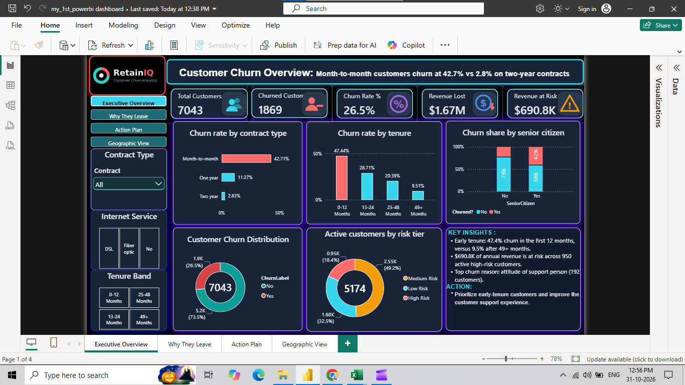
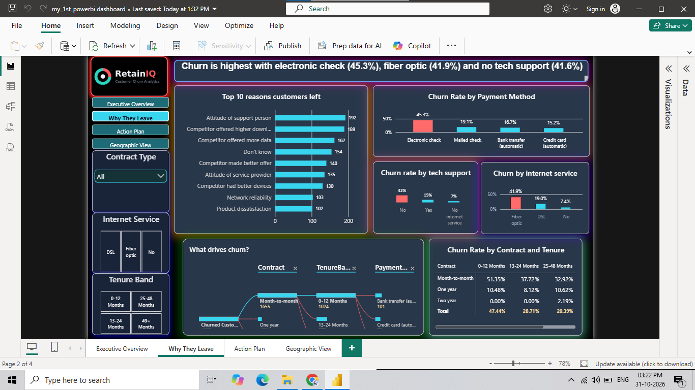
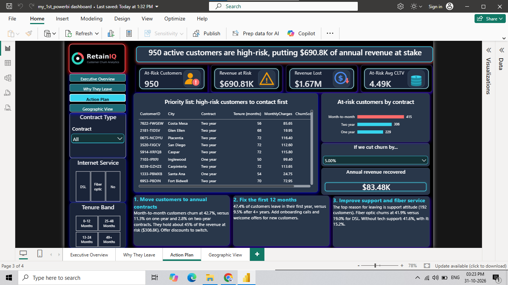
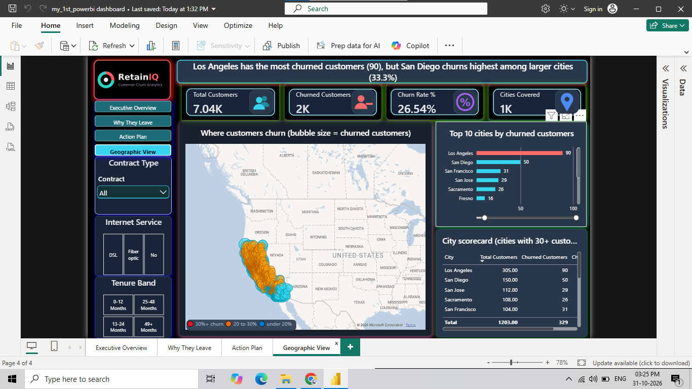

# Customer Churn Analytics: SQL + Power BI

> Most churn dashboards tell you who left. This one tells you who is about to.

An end-to-end analytics project on **7,043 telecom customers**: raw data → SQL cleaning and risk segmentation → a 4-page Power BI dashboard that explains why customers leave, ranks the high-risk customers a retention team should call first, and sizes the savings from reducing churn.



**Demo video:** [add your YouTube or LinkedIn link here]

---

## Business problem

26.5% of customers left, which cost about **$1.67M in annual revenue**. The retention team needs to know **why** customers leave, **who** is likely to leave next, and **what** reducing churn is worth, so it can decide where to spend its budget.

## Key findings

| Finding | Figure |
|---|---|
| Overall churn rate | **26.54%** (1,869 of 7,043 customers) |
| Annual revenue lost to churn | **$1,669,570** |
| Churn by contract | Month-to-month **42.71%**, one-year 11.27%, two-year **2.83%** |
| Churn by tenure | 0-12 months **47.44%**, 13-24 months 28.71%, 25-48 months 20.39%, 49+ months **9.51%** |
| Churn by payment method | Electronic check **45.29%**, mailed check 19.11%, bank transfer 16.71%, credit card 15.24% |
| Churn by internet service | Fiber optic **41.89%**, DSL 18.96%, no internet 7.40% |
| Churn by tech support | Without **41.64%**, with 15.17% |
| Churn by age group | Senior citizens **41.68%**, others 23.61% |
| Top reasons given | Attitude of support person (192), competitor offered higher download speeds (189), competitor offered more data (162) |
| High-risk active customers | **950**, representing **$690,811** in annual revenue |
| Where the at-risk revenue sits | Month-to-month holds about **$308.8K** (45%) |
| What-if savings | Reducing churn by 10% recovers about **$167K** a year |

## Dashboard pages

| Page | Purpose |
|---|---|
| **1. Executive Overview** | KPI cards, churn by contract and tenure, churn distribution, active customers by risk tier, churn by senior citizen |
| **2. Why They Leave** | Top 10 churn reasons, churn by payment method, tech support and internet service, decomposition tree, contract × tenure matrix |
| **3. Action Plan** | Priority list of high-risk customers (sorted by lifetime value), at-risk customers by contract, what-if churn reduction slider, three recommendations |
| **4. Geographic View** | Map of churned customers, top 10 cities, city scorecard |





## Recommendations

1. **Move customers to annual contracts.** Month-to-month churn is 15 times higher than two-year churn.
2. **Fix the first 12 months.** Nearly half of first-year customers leave, so add onboarding calls and welcome offers.
3. **Improve support and fiber optic service.** Support attitude is the top reason for leaving, and fiber optic and no-tech-support customers churn far above average.

## Tech stack

| Tool | Used for |
|---|---|
| **SQL** | Loading, cleaning, tenure bands, risk tiers (window functions, CTEs), views for the model |
| **Power BI** | Data model, DAX measures, what-if parameter, decomposition tree, map, drill-through |
| **DAX** | Churn rate, revenue lost and at risk, average CLTV, potential savings |
| **Python (optional)** | `scripts/clean_data.py` independently reproduces the cleaned file as a check |

## Data

- **Source:** the IBM Telco Customer Churn sample dataset (obtained via Kaggle). It is a sample dataset published for analytics practice, so these are not real customers.
- **Raw file:** 7,043 rows × 33 columns. **Cleaned file:** 7,043 rows × 35 columns.
- Check the original source's terms before reusing the data.

### Cleaning summary

| Issue | Treatment |
|---|---|
| `Total Charges` stored as text with 11 blank values | The 11 customers all have 0 months of tenure (not yet billed), so blanks were set to 0 and the column converted to a number |
| `Churn Reason` empty for 5,174 rows | These are exactly the customers who stayed. Filled with `Not Churned` |
| Constant or duplicated columns (`Count`, `Country`, `State`, `Lat Long`) | Removed |
| Inconsistent column names | Standardised to PascalCase (for example `TenureMonths`) |
| No duplicates found | Checked on `CustomerID` and full rows |
| Label consistency | `Churn Label` matches `Churn Value` in all rows |

### Columns added

`TenureBand`, `TenureBandSort`, `AnnualRevenue` (monthly charges × 12), `RiskTier`, `MonthlyChargeBand`, `AtRiskActive`. Details are in [`data/data_dictionary.md`](data/data_dictionary.md) and [`docs/`](docs/).

## Repository structure

```
customer-churn-analytics-powerbi-sql/
├── README.md
├── LICENSE
├── requirements.txt
├── .gitignore
├── data/
│   ├── raw/Telco_customer_churn.xlsx
│   ├── cleaned/telco_churn_cleaned.csv
│   └── data_dictionary.md
├── sql/
│   ├── 01_create_database_and_tables.sql
│   ├── 02_data_cleaning.sql
│   ├── 03_star_schema_views.sql
│   ├── 04_churn_analysis_queries.sql
│   └── 05_customer_segmentation_risk_tiers.sql
├── scripts/
│   └── clean_data.py
├── powerbi/
│   ├── Customer_Churn_Dashboard.pbix
│   ├── dax_measures.md
│   ├── theme/RetainIQ_Cyber_Theme.json
│   └── assets/            (logo and KPI icons)
├── screenshots/
└── docs/
    ├── business_problem.md
    ├── key_insights.md
    └── recommendations.md
```

## How to reproduce

**Option A: SQL route (main)**
1. Create a database and load `data/raw/Telco_customer_churn.xlsx` (or its CSV export) into a table called `raw_telco_churn`.
2. Run the scripts in `sql/` in numeric order.
3. Open `powerbi/Customer_Churn_Dashboard.pbix` in **Power BI Desktop** (Windows). Point the data source at your database, or at `data/cleaned/telco_churn_cleaned.csv`.

**Option B: Python check (optional)**
```bash
pip install -r requirements.txt
python scripts/clean_data.py
```
This rebuilds `data/cleaned/telco_churn_cleaned.csv` from the raw file and prints the headline numbers (7,043 customers, 26.54% churn, $1,669,570 lost, 950 at-risk). Your SQL output should match them.

To apply the dashboard look, import `powerbi/theme/RetainIQ_Cyber_Theme.json` in Power BI (View → Themes → Browse for themes).

## Key DAX measures

| Measure | Definition |
|---|---|
| Churn Rate % | Churned customers ÷ total customers |
| Revenue Lost | Annual revenue of churned customers |
| Revenue at Risk | Annual revenue of active customers with churn score of 70 or more |
| At-Risk Avg CLTV | Average customer lifetime value of the at-risk group |
| Potential Savings | Revenue Lost × churn reduction % (what-if parameter) |

The full list with explanations is in [`powerbi/dax_measures.md`](powerbi/dax_measures.md).

## Assumptions and limitations

- **Risk tiers:** High Risk is a churn score of 70 or more, Medium is 40 to 69, Low is below 40. These cut-offs are my choice, not part of the source data.
- **Churn score:** it comes from the IBM dataset. It was not modelled in this project.
- **Currency:** all amounts are in US dollars.
- **Potential Savings** assumes that reducing churn by X% recovers X% of the annual revenue currently lost. It is a planning estimate, not a forecast.
- **Snapshot data:** the dataset has no time dimension, so there is no trend analysis.
- **Map:** it plots zip-code level coordinates, so a single bubble can represent very few customers.
- The findings show association, not proven cause.

## Author

**[Ajim Mujawar]** | Data Scientist | AI & ML Engineer
[LinkedIn](https://www.linkedin.com/in/ajim-mujawar-data-scientist) · [GitHub](https://github.com/ajimmujawar44) · ajimmujawar44@gmail.com

Open to Data Analyst and BI Analyst roles. Feedback on the model or the DAX is welcome.

## License

Code and documentation: MIT (see `LICENSE`). The dataset belongs to its original publisher.
